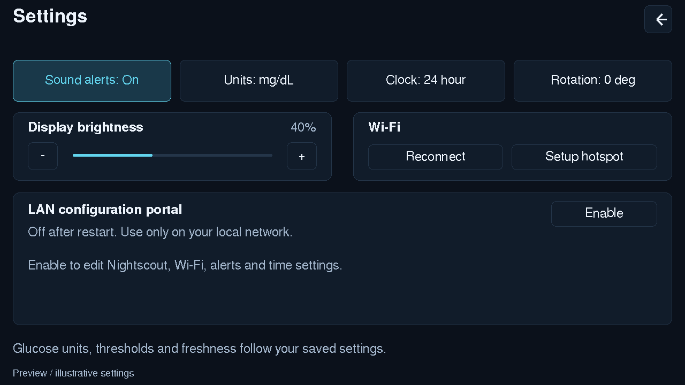
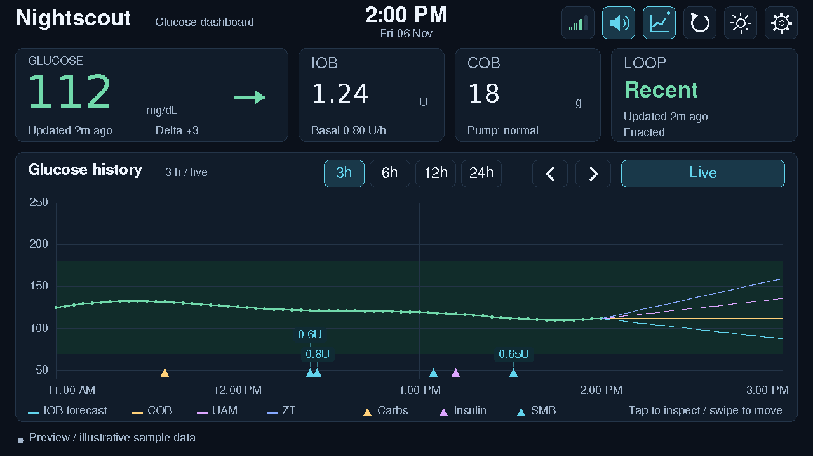

# M5Stack Tab5 Nightscout Dashboard

**Rotation update:** built and flashed successfully on the connected Tab5. The rotation option saves its preference and uses the native display/touch transform.

Standalone PlatformIO firmware for a native **1280 × 720 landscape touchscreen**. Derived from the supplied Core2 release dated 2026-11-04. The original archive and public Core2 repository have not been modified. No GitHub repository has been created or published.

## What is implemented

- Graph-first dashboard with dynamic glucose scale, saved low/high target shading, vector trend arrows (including double/diagonal directions), delta, 3/6/12/24-hour views, touch inspection and horizontal swipe/hour navigation.
- Full-day fetch cache, bounded at 288 glucose readings (24 hours at five-minute cadence). Gaps over ten minutes are not joined. Faster CGM cadences may yield less than a day; the display reports the history limit. Treatment markers show insulin/SMB and carbohydrates; tap nearby for amounts. V3 fetches a full-day window in pages of 200 (up to 16 pages) and caches up to 512 relevant markers, deduplicating page overlaps. A full page alone does not trigger a warning. Network scheduling and a one-tick pause during TLS receive polling let CPU0 idle work run during multi-page responses, with the system watchdog still enabled. Actual cache/request-budget truncation is still reported. Legacy mode retains its single bounded 200-record response. Dense markers can overlap.
- IOB/COB, fresh/stale loop state, pump and expiring basal values. Four uploader forecast lines (IOB/COB/UAM/ZT) keep their five-minute indices and disappear when stale. Forecasts are supplied by Nightscout; this device does not calculate doses or predictions.
- Visual low/high/stale state, selectable Trio glucose and missing-update sounds. Missing-update sounds retain the Core2 fixed ten-minute policy and startup grace. Sound can be disabled independently of visual status.
- Saved night mode dims the display; settings temporarily raise brightness. Graph and data remain available at night.
- Original v3 JWT renewal and explicit legacy API mode; bounded JSON parsing, settings revision checks, stale snapshots, prioritized Wi-Fi, temporary provisioning hotspot and protected LAN configuration portal.
- Certificate-verified HTTPS with the original 118 Mozilla/certifi 2026.10.23 CA roots. See TLS differences below.

## Display and touch controls

**SMB display:** every view has a 46-pixel SMB strip under the glucose plot, so dose labels never cover the trace. SMBs are summed into fixed local-clock buckets, about twelve per view (5 min at 1h, 15 min at 3h, 30 min at 6h, 1 hour at 12h, 2 hours at 24h). Each bucket shows its total with a small bar scaled to the busiest bucket in view. Buckets stay put between redraws, and every carb, insulin and SMB triangle sits at its exact time along the top of the strip. Tap the strip for a bucket's time span, dose count and total; tap the plot for individual readings and treatments. On the night clocks change, one bucket may start on an odd hour.

**Glucose scale:** the vertical scale fits each view: visible readings plus any forecast lines being drawn, padded by 10% (at least 10 mg/dL) and never narrower than 60 mg/dL. Gridline spacing adapts to the span (mg/dL or mmol/L steps). The target band is drawn wherever it intersects the scale. Time-axis ticks fall on round local hours (15 min / 1 h / 2 h / 3 h / 6 h for 1/3/6/12/24 h).

**Loop card side column:** the right side of the Loop card shows the AAPS phone (uploader) battery and CAGE / SAGE / IAGE. The phone battery comes from `uploaderBattery` / `isCharging` (or `uploader.battery`) on the selected loop devicestatus, colored green / amber (30% or less) / red (15% or less), cyan with a bolt while charging, and `--` once the loop record is older than the AAPS freshness setting. Ages come from the latest `Site Change`, `Sensor Start` or `Sensor Change`, and `Insulin Change` treatments in the last 30 days (one small v3 request with `eventType$in`), shown as hours under two days and then days + hours. They are refreshed with treatments at most every 10 minutes, or one minute after a live treatment change; a failed request keeps the previous ages and never affects alarms. Colors: amber at the warn age, red at the urgent age. CAGE and IAGE use Nightscout's defaults (warn 48 h, urgent 72 h); SAGE is set for a 10-day sensor (warn 228 h, urgent 240 h) in `include/care_age.h`. Tap the column for the full detail.

**IOB card pump indicators:** right-aligned on the IOB heading line are the pump reservoir (cartridge icon, e.g. `123U`, one decimal under 10 U, or the pump's own `reservoir_display_override` such as `50+U`) and the pump battery (gauge icon with percent, or volts for pumps that report voltage). Both come from the `pump` block of the selected loop devicestatus and show `--` once it is older than the AAPS freshness setting. Colors follow Nightscout's pump-plugin defaults: reservoir amber below 10 U and red below 5 U; battery amber below 30% and red below 20% (1.35 V / 1.30 V). Thresholds are in `include/pump_status.h`. Tap the indicators for the values and their age.

**Rotation:** tap **Settings > Rotation: 0 deg / 180 deg**. This flips the landscape dashboard and Settings together, keeping 1280x720 resolution. The choice is saved separately in the Tab5 preferences and restored at boot. M5Stack's native display rotation also supplies the transformed touch coordinates; no separate manual coordinate flip is applied.



**Clock format:** tap **Settings > Clock: 12 hour / 24 hour**. This changes both the centered clock and graph-axis labels, using AM/PM in 12-hour mode. It is saved in the Tab5 preference namespace separately from the Nightscout profile; existing devices default to 24-hour mode. RTC storage and NTP synchronization remain UTC in either display mode.


A centered clock and date use the saved POSIX time zone, including its daylight-saving rules. The Tab5's built-in RTC restores system UTC at startup, and successful network time synchronization writes UTC back to it. This keeps the clock available during Wi-Fi outages while the device/RTC retains valid time. If no valid clock is available, the header shows `--:--` and `Waiting for time` instead of an epoch date.

The dashboard uses native-size FreeSans labels/headings and DejaVu numeric fonts rather than enlarging the small bitmap font. Glucose, IOB, COB and loop freshness have separate cards. The chart has a subdued target band, higher-contrast labels, smoother traces and a compact color-key legend. Connection/error information occupies a separate footer; full cached glucose history does not produce a warning when the selected view is covered.

Top-right controls, left to right: **Wi-Fi signal**, **Sound**, **Forecast**, **Refresh**, **Day/Night**, **Settings**. The four Wi-Fi bars use the Core2 thresholds (-55/-67/-75 dBm), with a disconnected slash and a five-second RSSI sampling interval for the C6 radio. Tap the indicator for its signal reading. Tap the speaker to mute/unmute glucose and missing-update sounds; the crossed speaker means muted, and the saved state stays in sync with Settings. A highlighted forecast icon means the overlay is enabled; the sun/moon shows the current display mode. Buttons give brief text feedback after activation. Header icon targets are 52 × 52 pixels. Settings use larger text and grouped controls for alerts, units, brightness, Wi-Fi and the LAN portal. The arrow at the top right returns to the dashboard and cancels hotspot setup when active.



## Hardware and build constraints

Target: Tab5 C145/K145, ESP32-P4, 16 MB flash, 32 MB PSRAM, ESP32-C6 radio over SDIO. This is **not** an ESP32-S3 or a Core2 build. M5Unified/M5GFX initialize the MIPI-DSI display, touch, power expanders and speaker; this project does not substitute an SPI panel driver. A 1.84 MB RGB565 UI buffer lives in PSRAM, with an explicit startup failure if allocation fails.

The pinned `tab5` environment uses the generic P4 evaluation-board definition for **engineering-sample / pre-rev-3.00 silicon**, as in M5Stack's Tab5 PlatformIO guidance. Radio SDIO pins are explicitly set to CLK12/CMD13/D0=11/D1=10/D2=9/D3=8/RESET15. The firmware is a P4 host application and expects a compatible factory ESP-Hosted image already on the C6. It does not flash the C6. Wi-Fi failure may require the vendor's host/slave version matching procedure; do not overwrite the radio with an unrelated C6 sketch.

For P4 revision 3.x silicon, select `tab5-rev3` after checking the actual chip revision with esptool/vendor documentation. This changes the P4 SDK variant, not the screen type. Neither environment is hardware-certified here.

Display revisions are a separate issue: original ILI9881C + GT911, replacement ST7123 (from October 14, 2025), and ST7121. Check the rear sticker. M5Stack documents reset handling fixes in M5Unified >=0.2.23 / M5GFX >=0.2.30; this project pins 0.2.28 / 0.2.35. Detection belongs to these libraries. On startup the project verifies a 1280 × 720 landscape surface; orientation, touch mapping, speaker and each panel revision still require physical validation.

Pinned toolchain: pioarduino 55.03.37, Arduino ESP32 3.3.7, M5Unified 0.2.28, M5GFX 0.2.35, ArduinoJson 6.21.5. Use **Python 3.10–3.13**; this platform rejects Python 3.14. First build needs internet and several GB of free space.

## Windows PowerShell helper

Keep `Flash-Tab5.ps1` beside `platformio.ini` in the extracted project. Install Python 3.13 (including pip/venv) first. The script finds Python 3.10–3.13, creates `.build-tools/` locally, and installs pinned PlatformIO if needed. First build requires internet access.

```powershell
# Find your device's COM port:
powershell -NoProfile -ExecutionPolicy Bypass -File .\Flash-Tab5.ps1 -ListPorts
# First run creates config.h and stops for editing; rerun to build and flash:
powershell -NoProfile -ExecutionPolicy Bypass -File .\Flash-Tab5.ps1 -Port COM5
# Or configure Wi-Fi/Nightscout through the device portal after flashing:
powershell -NoProfile -ExecutionPolicy Bypass -File .\Flash-Tab5.ps1 -UsePortal -Port COM5
# Build without flashing:
powershell -NoProfile -ExecutionPolicy Bypass -File .\Flash-Tab5.ps1 -BuildOnly
# View diagnostics after upload (Ctrl+C to close):
powershell -NoProfile -ExecutionPolicy Bypass -File .\Flash-Tab5.ps1 -Monitor -Port COM5
```

Replace COM5 with your device's port, or omit `-Port` to let PlatformIO select one. `-PythonPath C:\Python313\python.exe` chooses an interpreter explicitly. `-Revision3` selects revision-3.x silicon; use it only when it matches the actual P4 chip. `-InitConfig` only creates configuration if absent; existing configuration is never overwritten. `-DryRun` prints the planned action without changing files or contacting a device. Upload occurs only after a successful build. The helper does not erase settings or flash the C6 radio. Build history and current validation results are recorded in VERIFICATION.md.

**Local toolchain (this PC):** the pinned PlatformIO core lives in `.toolchain\pio`, running on the portable Python in `.toolchain\python` (Zig and ArduinoJson 6.21.5 for host tests are in `.toolchain\zig` and `.toolchain\arduinojson`). It is git-ignored. Double-click `.review-tools\RUN-build-flash.cmd` to build, upload and capture 60 s of serial output into `verification\`. If the project folder is moved again, rewrite the absolute paths in `.toolchain\pio\penv\pyvenv.cfg`, the penv `Scripts` launchers and `.toolchain\pio\idf-env.json`, or delete `.toolchain` and let PlatformIO reinstall.

## Build and provision

```sh
python -m pip install platformio==6.2.0
python -m platformio run -e tab5
python -m platformio run -e tab5 -t upload
python -m platformio device monitor -b 115200
```

Use the USB-C data port. If automatic upload fails, hold the power button until the green LED blinks to enter download mode. Set the upload port explicitly if needed. Use reliable USB power during initial validation.

Optional compiled defaults: copy `include/config.example.h` to `include/config.h`, then edit locally. It is ignored by Git. Never commit your URL/token/passwords or configured binaries. Otherwise:

1. Open **Settings → Wi-Fi setup hotspot**. Join the temporary network using the displayed password; browse to `http://192.168.4.1`. Setup expires in five minutes; Back cancels. Polling pauses during provisioning while cached data continues aging.
2. Once connected, open **Settings → Open LAN portal**. Browse to the displayed port-3000 address and enter the displayed access code.
3. Enter HTTPS Nightscout origin/path (no trailing slash), read-only subject access token, v3/legacy mode, uploader filter, networks, time zone/NTP, display and alert settings. Blank secret fields retain current values. Save and test the connection.
4. Close the portal when finished. It is off on every reboot. It uses HTTP on the trusted local LAN, with login throttling, expiring sessions, exact origin/host and CSRF checks. It is not an internet-facing management service. NVS settings are not encrypted by this project.

Settings preserve the Core2 schema and migration paths on the same NVS partition. Copying settings between physical devices is not automated. Normal uploads preserve NVS; erasing flash removes settings. Night mode uses a separate Tab5 preference.

## TLS port decision

The Tab5 uses `setCACertBundle()` with the same 118 roots in the ESP-IDF 5.5.2 offset-table format (`certs/tab5_crt_bundle.bin`). A project-linked adapter in `src/ca_bundle.cpp` implements the pinned SDK bundle interface and ports the Core2 root-key anchor policy to mbedTLS 3. The roots stay in flash instead of being parsed as a full PEM chain in internal RAM. TLS allocations prefer PSRAM with internal-memory fallback, installed before the network workers start.

This also handles a server presenting a cross-signed root: trust requires the exact reviewed DER subject **and public key**. An external parent/signature is unnecessary for an already-trusted anchor. Other presented certificates must verify their signatures against a trusted issuer. Hostname, date, usage, key/algorithm and revocation failures are preserved. No insecure fallback is enabled. Certificate-verification diagnostics include flags and public fingerprints, not credentials or glucose values.

The first PEM port failed with an SSL allocation error on the device. The subsequent native SDK bundle removed that error but rejected a cross-signed GTS Root R4 presentation whose key was already in the trusted store. The current adapter carries forward the original Core2 handling for this case rather than changing the CA roots.

Regenerate the runtime data with `python tools/build_tab5_bundle.py` after a reviewed CA update. Its output matches Espressif's official 5.5.2 generator byte for byte. The Core2 big-endian count-prefixed `x509_crt_bundle.bin` is reference data and is not interchangeable. `ca_pem.h` is also reference data and is not included in production. The adapter depends on the pinned framework interfaces; upgrades require rebuilding and rerunning certificate tests.

## Structure and checks

Reliability: the UI/alarm loop is covered by a 30-second task watchdog that reboots the device if it hangs. The three ~64 KiB data snapshots (UI, network worker, hand-off) live in PSRAM, leaving internal RAM for TLS. V3 loop status reads the newest 10 devicestatus records so uploads from other apps (e.g. xDrip+ battery) cannot hide AAPS data.

`src/main.cpp` owns the retained acquisition worker, settings integration and alert scheduling. `include/tab5_ui.h` owns native rendering/touch; `tab5_graph.h` owns geometry. The retained model, treatment, API, portal and settings headers remain separately testable. `docs/core2-reference/` contains historical upstream notes, not Tab5 feature guarantees. License and certifi attribution are included.

```sh
python test/test_ca_bundle.py
node test/test_ca_bundle_node.cjs
node test/test_portal_frontend.cjs
# Host C++ fixtures (a C++17 compiler and ArduinoJson 6.21.5 include path):
g++ -std=c++17 -Itest/compat -Iinclude -I/path/to/ArduinoJson/src test/host.cpp -o parser-tests
./parser-tests
# Alternatively compile/run the fixtures on a Tab5:
python -m platformio run -e parser-tests -t upload
```

Read [VERIFICATION.md](VERIFICATION.md) for measured results and remaining checks. This is a monitoring display, not a dosing controller; no treatments or pump commands are sent. Do not use its alerts as the sole alarm source.

## Primary sources

- [Original Core2 repository](https://github.com/stavlor/M5Stack-core2-Nightscout)
- [M5Stack Tab5 hardware, panel revisions and PlatformIO guidance](https://docs.m5stack.com/en/core/Tab5)
- [M5Stack Tab5 Wi-Fi SDIO pin example](https://docs.m5stack.com/en/arduino/m5tab5/wifi)
- [Pinned pioarduino release](https://github.com/pioarduino/platform-espressif32/releases/tag/55.03.37)

## Live updates and history backfill

Settings > **Live updates** enables the read-only Nightscout v3 `/storage` Socket.IO listener (on by default, saved separately in `ns-tab5`). The footer says **Live updates** only after Nightscout acknowledges read subscriptions for entries, devicestatus and treatments. Legacy API mode continues polling. The existing poll setting controls the fallback interval; connection failures use the existing bounded retry delay.

Create, update and delete notifications are coalesced for 1.5 seconds, then the affected collection is reloaded through the existing verified HTTPS API. Notification documents never replace the validated REST cache. Each glucose/treatment reload covers the cached 24-hour window, including paged treatments, so edits, deletions and late uploads within that window are picked up. This deliberately favors complete collection snapshots over fragile incremental merges. Cache limits remain 288 glucose points / 512 treatment markers, with existing truncation notices.

Full refreshes of all three collections run at startup, after each successful live subscription/reconnection, on Refresh, and after saving settings the network task uses (server/token, Wi-Fi, poll/stale times, time zone/NTP). Changing the graph range, browsing history or saving display/alert-only settings redraws from the full-day cache without a network request. A periodic full refresh also runs while live: half the shorter configured freshness threshold, bounded to 30–300 seconds. Partial live refreshes do not postpone that deadline. The graph remains limited to the most recent 24 hours.

The listener uses Engine.IO4 / Socket.IO4 over a direct WebSocket upgrade at the configured URL prefix plus `/socket.io/`. It checks the upgrade response and WebSocket accept hash, masks client frames, services both WebSocket and Engine.IO heartbeats, supports fragmented text, bounds live messages to 64 KiB in PSRAM, and uses the same CA-verified TLS client as REST. Existing live heartbeats are serviced during long REST responses. Socket reconnects back off from 5 to 300 seconds with jitter; a failed/unsupported subscription falls back to polling and is never labeled live. Proxies must allow WebSocket upgrades; older Socket.IO protocols, IPv6 URL literals and custom socket paths are not supported by this listener. REST polling remains available.

Only read subscriptions and protocol heartbeat replies are sent; no Nightscout records or alarm acknowledgements are written. Tokens and live clinical payloads are excluded from serial diagnostics. Turning Live updates off closes the listener on the network task and immediately requests a full polling refresh.

Protocol references: [Nightscout storage socket](https://github.com/nightscout/cgm-remote-monitor/blob/master/lib/api3/storageSocket.js), [Socket.IO protocol](https://socket.io/docs/v4/socket-io-protocol/), [Engine.IO protocol](https://socket.io/docs/v4/engine-io-protocol/), [RFC6455](https://www.rfc-editor.org/rfc/rfc6455).

## Battery / power indicator

A battery tile sits immediately before Wi-Fi and Sound in the dashboard header. It shows the M5Unified voltage-based percentage estimate (`~`), with green above 30%, amber at 16–30%, and red at 15% or below. A cyan bolt means the charger reports charging and the measured pack current is greater than 10 mA. Tap for estimated percentage, pack voltage and charging/discharging/idle status. Samples refresh every five seconds on the UI task.

Tab5 reports its 2S pack voltage/current through INA226; this is not a calibrated fuel-gauge percentage. Invalid/unavailable pack readings show `Power --` rather than 0%. The pinned driver does not provide reliable pack-presence or external-input sensing on Tab5: a floating charger rail can resemble a pack, so the tile does not claim USB presence, battery absence or remaining runtime. Charger settings are unchanged. Hardware reference: [M5Stack Tab5 Power Manager](https://docs.m5stack.com/en/arduino/m5tab5/power).

## Trio alert sounds

Open **Settings > Alert sounds**. Pick a sound independently for Low glucose, High glucose, Glucose stale and Loop stale, then choose **Mild / Medium / Harsh**. Choices include all six Acoustic and six Electronic sound categories, each with three recordings, plus eight standalone tones. The intensity selection changes the actual Acoustic/Electronic recording, independently of speaker volume. The eight standalone tones each have a single recording. Selection, intensity and the existing volume/mute setting are saved.

Defaults are Acoustic Low (LG), High (HG), Time-sensitive (DTS) for stale glucose and Device critical (DCR) for stale loop, all at Medium intensity. Low soon (LGS) and Urgent low (ULG) are available as alternate sound recordings; **selecting them does not create predictive or urgent-low alert triggers**. The existing low/high thresholds, low repeat interval and fixed ten-minute stale policy/startup grace remain unchanged. Stale glucose and stale loop retain separate episodes and sound in sequence when both arise. No Nightscout records are modified.

Alarm sounds never play below a speaker volume of 32/255 (about 13%), even if a lower value or 0 is saved; use the speaker toggle to silence them. Use **Speaker check** for a short test tone, or **Preview** to hear the selected sound at the saved volume. Preview respects mute and can be stopped; a newly due real alert interrupts a preview, and glucose alerts take priority over stale-data audio. Alarm episodes are consumed only after audio is accepted by the speaker. Playback runs on M5Unified's speaker task without waiting for the whole clip in the UI loop. All PCM stays in flash for its full playback lifetime; no transient audio buffers or runtime AAC decoder are needed.

The 44 supplied M4A originals are retained in `assets/trio/source`, with attribution and the Trio MIT licence in `assets/trio/ATTRIBUTION.md`. `tools/build_trio_audio.py` uses FFmpeg to produce 12 kHz mono unsigned 8-bit PCM with offline per-clip peak normalization to +/-112 (about -1.2 dBFS). This brings quiet recordings closer to the speaker-check level without clipping, while preserving timing, rhythm and timbre. The pack fits the existing application partition. The resulting flash pack is 3,490,037 bytes. `manifest.json` records every source/PCM hash, offset and sample count. Regenerate with `python tools/build_trio_audio.py`; FFmpeg is only needed for regeneration, not ordinary firmware builds.

Run `python test/test_audio_assets.py` for the complete pack/source integrity check. Host fixtures also cover all sound mappings, stored-setting validation and small-dose/three-lane label behavior. The settings previews are illustrative layouts with the actual native font glyphs, not device screenshots.

Tab5 audio uses 48 kHz, two-slot I2S output to the ES8388 (mono clip data is duplicated by M5Unified). The project-local DAC startup adapter starts a short silent clock stream, applies DAC-only clock/mixer/state-machine setup, then queues the requested sound. The 10 ms startup wait occurs once per boot, not for the duration of a clip. Codec/amp readback diagnostics report hardware state without clinical values. Reference: [Espressif ES8388 codec startup](https://github.com/espressif/esp-adf/blob/master/components/esp_codec_dev/device/es8388/es8388.c). Hardware audibility must be verified on the target; accepting a speaker queue request alone is not proof of sound output.
